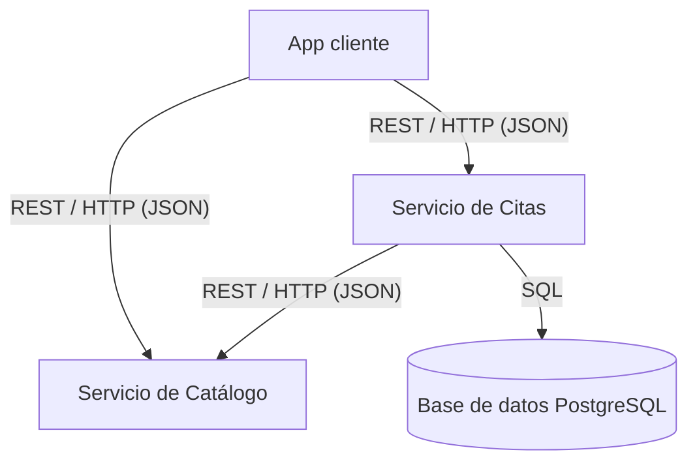

# Plataforma de Citas para Salón de Uñas

Proyecto de la asignatura **Cloud Computing: Fundamentos e Infraestructuras** — Máster Universitario en Ingeniería Informática, ETSIIT, Universidad de Granada (curso 2026-2027).

Aplicación nativa de la nube (*Cloud-Native Application*) para gestionar las citas de un salón de uñas: catálogo de servicios, cálculo automático de precio y duración, búsqueda de huecos disponibles y gestión de reservas.

[](https://github.com/ChaimaeMoussaoui8/nail-booking-cloud/actions/workflows/ci.yml)

## Estado actual del proyecto

| Hito | Contenido | Estado |
|---|---|---|
| Hito 1 | Definición del proyecto, modelo de negocio y arquitectura | Completado |
| Hito 2 | Microservicios, contenedores, Docker Compose e integración continua | Completado |
| Hito 3 | Infraestructura como código | Pendiente |
| Hito 4 | Despliegue continuo | Pendiente |
| Hito 5 | Observabilidad, pruebas de carga y versión final | Pendiente |

Los dos microservicios están implementados en **Python 3.13 con FastAPI**, con sus pruebas unitarias y de integración. La aplicación completa se levanta en local con un único comando (`docker compose up`).

---

## Índice

1. [Descripción del dominio](#1-descripción-del-dominio)
2. [Justificación NIST SP 800-145](#2-justificación-nist-sp-800-145)
3. [Mapeo de actores NIST SP 500-292](#3-mapeo-de-actores-nist-sp-500-292)
4. [Arquitectura](#4-arquitectura)
5. [Especificación de la API REST](#5-especificación-de-la-api-rest)
6. [Ejecución en local](#6-ejecución-en-local)
7. [Contenedores](#7-contenedores)
8. [Integración continua](#8-integración-continua)
9. [Gestión del proyecto](#9-gestión-del-proyecto)

---

## 1. Descripción del dominio

### Problema de negocio

Muchos salones de uñas gestionan su negocio casi exclusivamente a través de Instagram: los clientes consultan precios, piden citas, las cambian o las cancelan mediante mensajes directos. Cuando el volumen de mensajes es alto, este sistema es difícil de controlar:

- Los mensajes se acumulan y algunos se pierden o se responden con mucho retraso.
- El personal dedica mucho tiempo a responder preguntas repetidas (precios, duración, disponibilidad).
- Se producen errores de agenda: citas solapadas, huecos mal calculados o cancelaciones no registradas.
- Los clientes que no reciben una respuesta rápida acaban reservando en otro salón.

### Solución propuesta

Una aplicación que automatiza la gestión de citas del salón. El cliente consulta el catálogo, obtiene el precio y la duración exactos de la combinación de servicios que elige y reserva directamente un hueco disponible. El salón deja de depender de los mensajes de Instagram para la gestión diaria.

### Lógica de negocio

La aplicación no se limita a guardar y mostrar datos. Aplica las siguientes reglas:

- **Cálculo de precio y duración:** cada cita es una combinación de un servicio base (ej. manicura BIAB) y extras (ej. francesa, retirada de gel, diseño en varias uñas). El sistema calcula el precio y la duración totales, incluyendo extras cuyo precio depende del número de uñas.
- **Búsqueda de huecos:** solo se muestran los huecos en los que un técnico trabaja y tiene libre todo el tiempo que dura el servicio.
- **Prevención de solapamientos:** un técnico no puede tener dos citas que coincidan en el tiempo.
- **Política de cancelación:** una cita solo puede cancelarse hasta 24 horas antes. Al cancelar, el hueco se libera automáticamente.

### Catálogo de ejemplo

| Servicio base | Precio | Duración |
|---|---|---|
| Manicura simple | 25 € | 45 min |
| Manicura japonesa | 35 € | 60 min |
| Manicura BIAB | 40 € | 75 min |
| Extensiones | 65 € | 120 min |
| Pedicura simple | 35 € | 60 min |
| Pedicura japonesa | 45 € | 75 min |
| Pedicura BIAB | 45 € | 80 min |

| Extra | Precio | Duración |
|---|---|---|
| Francesa / Cromo / Ombré | +10 € | +15 min |
| Cat eye | +7 € | +10 min |
| Diseño (por uña) | +2 € | +5 min |
| Reparación (por uña) | +3 € | +10 min |
| Retirada de gel o BIAB | +15 € | +20 min |

### Casos de uso principales

- **Consultar el catálogo:** ver los servicios base y los extras con sus precios y duraciones.
- **Calcular precio y duración:** obtener el total de la combinación elegida.
- **Consultar disponibilidad:** ver los huecos libres de una fecha con duración suficiente para el servicio elegido.
- **Reservar una cita:** confirmar un hueco con un técnico; el sistema impide los solapamientos.
- **Cancelar una cita:** permitido solo hasta 24 h antes; el hueco queda libre de nuevo.
- **Consultar la agenda del día:** cada técnico ve sus citas de una fecha.

---

## 2. Justificación NIST SP 800-145

La aplicación aprovecha las cinco características esenciales del Cloud Computing definidas por el NIST:

| Característica | Aplicación en el proyecto |
|---|---|
| **Autoservicio bajo demanda** | El salón puede desplegar, ampliar o reducir los recursos (instancias, base de datos) de forma automática mediante código (Terraform) y pipelines de CI/CD, sin intervención manual del proveedor. |
| **Acceso amplio a la red** | Los clientes reservan desde cualquier dispositivo (móvil, tablet, ordenador) a través de Internet mediante una API REST sobre HTTP, a cualquier hora, sin depender de que alguien responda mensajes. |
| **Asignación común de recursos** | La aplicación se ejecuta sobre la infraestructura compartida del proveedor cloud, que reparte sus recursos físicos entre muchos clientes. El salón no necesita comprar ni mantener servidores propios. |
| **Rápida elasticidad** | La demanda del salón tiene picos claros: viernes por la tarde, sábados y fechas previas a festivos, bodas o Navidad, frente a mañanas entre semana con poca actividad. Los servicios en contenedores pueden escalar para atender los picos y reducirse en los periodos tranquilos. |
| **Servicio medido** | El proveedor mide el uso de cómputo, almacenamiento y red, y el salón paga solo por lo que consume. En los periodos de poca demanda el coste se reduce. |

---

## 3. Mapeo de actores NIST SP 500-292

| Actor | Quién es en este proyecto |
|---|---|
| **Consumidor cloud** | El salón de uñas, que contrata los servicios cloud para ejecutar su aplicación. Indirectamente, sus clientes y técnicos usan la aplicación desplegada. |
| **Proveedor cloud** | El proveedor de infraestructura donde se despliega la aplicación (nube pública con capa gratuita o créditos de estudiante, o nube privada propia), en una región de la Unión Europea. |
| **Intermediario (*broker*)** | No se utiliza en esta versión: el salón contrata directamente al proveedor. Podría aparecer si el salón usara un servicio que gestione varios proveedores o un marketplace de software. |
| **Auditor** | Entidad independiente que puede evaluar la seguridad y el cumplimiento normativo. Es relevante porque la aplicación almacena datos personales de clientes (nombre, email e historial de citas), sujetos al RGPD, cuya autoridad de control en España es la AEPD. |
| **Operador (*carrier*)** | Los operadores de telecomunicaciones y proveedores de Internet que conectan a los clientes y al salón con la infraestructura del proveedor cloud. |

### Impacto económico

- **De CapEx a OpEx:** el salón no realiza una inversión inicial en servidores; paga un coste operativo mensual proporcional al uso.
- **Pago por uso:** gracias a la elasticidad, en los periodos de poca demanda el coste es menor que el de un servidor propio dimensionado para los picos.
- **Ahorro de tiempo del personal:** las horas que antes se dedicaban a responder mensajes de Instagram se pueden dedicar a atender clientes.
- **Menos pérdidas de clientes:** la reserva inmediata evita perder clientes por respuestas lentas y reduce los errores de agenda.

---

## 4. Arquitectura

La aplicación sigue una arquitectura de microservicios desacoplados que se comunican mediante una API REST.



### Componentes

| Componente | Responsabilidad |
|---|---|
| **Servicio de Catálogo** | Gestiona los servicios base y los extras. Calcula el precio y la duración totales de una combinación. El catálogo está definido en el código, ya que cambia muy poco. |
| **Servicio de Citas** | Gestiona los técnicos y sus horarios, calcula los huecos disponibles, crea citas sin solapamientos y aplica la política de cancelación. Consulta al Servicio de Catálogo para conocer la duración de los servicios. |
| **PostgreSQL** | Capa de persistencia del Servicio de Citas. Almacena las citas, que se conservan aunque se reinicien los contenedores. |

### Protocolos de comunicación

| Origen → Destino | Protocolo |
|---|---|
| App cliente → Catálogo / Citas | REST sobre HTTP, con datos en JSON |
| Citas → Catálogo | REST sobre HTTP, con datos en JSON |
| Citas → PostgreSQL | SQL sobre TCP |

---

## 5. Especificación de la API REST

### Servicio de Catálogo

| Método | Ruta | Descripción |
|---|---|---|
| `GET` | `/services` | Lista los servicios base |
| `GET` | `/extras` | Lista los extras |
| `POST` | `/quote` | Calcula el precio y la duración de una combinación |

**Ejemplo — `POST /quote`**

Petición:
```json
{
  "service_id": "manicura-biab",
  "extras": [
    { "extra_id": "francesa" },
    { "extra_id": "diseno", "nails": 2 }
  ]
}
```

Respuesta `200 OK`:
```json
{
  "total_price": 54,
  "total_duration_minutes": 100
}
```

### Servicio de Citas

| Método | Ruta | Descripción |
|---|---|---|
| `GET` | `/technicians` | Lista los técnicos |
| `GET` | `/availability?date=2026-11-14&duration=100` | Huecos libres de una fecha con duración suficiente |
| `POST` | `/appointments` | Crea una cita |
| `DELETE` | `/appointments/{id}` | Cancela una cita (solo hasta 24 h antes) |
| `GET` | `/technicians/{id}/appointments?date=2026-11-14` | Agenda de un técnico en una fecha |

**Ejemplo — `GET /availability?date=2026-11-14&duration=100`**

Respuesta `200 OK` (fragmento; se devuelve un hueco cada 15 minutos para cada técnico libre):
```json
[
  { "technician_id": 1, "start": "2026-11-14T10:00:00", "end": "2026-11-14T11:40:00" },
  { "technician_id": 1, "start": "2026-11-14T10:15:00", "end": "2026-11-14T11:55:00" },
  { "technician_id": 2, "start": "2026-11-14T10:00:00", "end": "2026-11-14T11:40:00" }
]
```

**Ejemplo — `POST /appointments`**

Petición:
```json
{
  "client_name": "Laura Pérez",
  "client_email": "laura@example.com",
  "technician_id": 1,
  "service_id": "manicura-biab",
  "extras": [{ "extra_id": "francesa" }, { "extra_id": "diseno", "nails": 2 }],
  "start": "2026-11-14T10:00:00"
}
```

Respuesta `201 Created`:
```json
{
  "id": 42,
  "client_name": "Laura Pérez",
  "client_email": "laura@example.com",
  "technician_id": 1,
  "start": "2026-11-14T10:00:00",
  "end": "2026-11-14T11:40:00",
  "total_price": 54,
  "status": "confirmed"
}
```

Respuesta `409 Conflict` si el hueco ya está ocupado:
```json
{ "error": "El técnico ya tiene una cita en ese horario" }
```

**Ejemplo — `DELETE /appointments/42`**

- `204 No Content` si la cancelación se realiza con más de 24 h de antelación.
- `422 Unprocessable Entity` si faltan menos de 24 h:
```json
{ "error": "Las citas solo pueden cancelarse hasta 24 horas antes" }
```

---

## 6. Ejecución en local

Requisitos: Docker con Docker Compose.

```bash
cp .env.example .env
docker compose up --build -d
docker compose ps
```

| Servicio | URL | Documentación interactiva |
|---|---|---|
| Catálogo | http://localhost:8001 | http://localhost:8001/docs |
| Citas | http://localhost:8002 | http://localhost:8002/docs |

Ejemplo de reserva:

```bash
curl -X POST localhost:8002/appointments -H 'Content-Type: application/json' -d '{"client_name": "Laura Pérez", "client_email": "laura@example.com", "technician_id": 1, "service_id": "manicura-biab", "extras": [{"extra_id": "francesa"}, {"extra_id": "diseno", "nails": 2}], "start": "2026-12-14T10:00:00"}'
```

Para parar el entorno: `docker compose down` (los datos se conservan en el volumen `db-data`).

### Orquestación (`compose.yaml`)

| Contenedor | Imagen | Puerto |
|---|---|---|
| `catalog` | Construida desde `services/catalog/Dockerfile` | 8001 |
| `appointments` | Construida desde `services/appointments/Dockerfile` | 8002 |
| `db` | `postgres:17-alpine` | No se expone fuera de la red interna |

- **Red interna aislada (`backend`)**: los contenedores se comunican por nombre (`http://catalog:8000`, `db:5432`).
- **Volumen persistente (`db-data`)**: los datos de PostgreSQL sobreviven a `docker compose down` y a los reinicios.
- **Variables de entorno**: las credenciales se leen de `.env`, que no se versiona. `.env.example` muestra las variables necesarias sin credenciales reales.
- **Orden de arranque**: el Servicio de Citas espera a que PostgreSQL esté listo (`healthcheck` con `pg_isready`).

### Tests

```bash
cd services/catalog          # o services/appointments
python3 -m venv .venv && source .venv/bin/activate
pip install -r requirements-dev.txt
pytest
```

Los tests de integración con PostgreSQL (`tests/test_db_store.py`) se ejecutan cuando la variable `TEST_DATABASE_URL` apunta a una base de datos de pruebas; en la integración continua se ejecutan siempre.

---

## 7. Contenedores

Cada microservicio tiene su propio `Dockerfile` de producción:

- **Construcción multietapa**: la primera etapa instala las dependencias en un entorno virtual (`/opt/venv`); la imagen final solo copia ese entorno y el código de la aplicación, sin herramientas de compilación ni caché de `pip`.
- **Imagen base `python:3.13-slim`**: versión oficial reducida de Debian. Es mucho más pequeña que `python:3.13` (cerca de 1 GB) y, a diferencia de las imágenes Alpine, usa glibc, la biblioteca para la que se publican la mayoría de paquetes precompilados de Python, lo que evita problemas de compatibilidad con librerías que tienen partes compiladas (`psycopg`, `uvloop`). La imagen final del catálogo ocupa unos 60 MB comprimida.
- **Usuario no root**: la aplicación se ejecuta con el usuario sin privilegios `appuser` (UID 10001).
- **Caché de capas**: `requirements.txt` se copia e instala antes que el código, por lo que un cambio en el código no reinstala las dependencias.
- **Puerto expuesto**: `EXPOSE 8000`.
- **`.dockerignore`**: excluye el entorno virtual, los tests y las cachés locales de la imagen.

---

## 8. Integración continua

El workflow [`.github/workflows/ci.yml`](.github/workflows/ci.yml) se ejecuta en cada `push` y `pull_request` a `main`:

| Job | Qué hace |
|---|---|
| **Linters** | `ruff` sobre el código Python y `hadolint` sobre los dos `Dockerfile`. |
| **Tests** | Ejecuta `pytest` en cada servicio. Levanta un PostgreSQL temporal para los tests de integración. |
| **Imagen** | Construye las imágenes de los dos servicios. En `main` las publica en GitHub Container Registry, etiquetadas con el hash del commit (`sha-…`) y `latest`, y con la versión semántica al crear una etiqueta `v*`. Solo se ejecuta si los linters y los tests pasan. |

Imágenes publicadas:

- [`ghcr.io/chaimaemoussaoui8/nail-booking-catalog`](https://github.com/ChaimaeMoussaoui8/nail-booking-cloud/pkgs/container/nail-booking-catalog)
- [`ghcr.io/chaimaemoussaoui8/nail-booking-appointments`](https://github.com/ChaimaeMoussaoui8/nail-booking-cloud/pkgs/container/nail-booking-appointments)

---

## 9. Gestión del proyecto

### Estrategia de ramas

- `main`: rama principal, siempre estable.
- `feature/<nombre>`: una rama por funcionalidad o tarea (ej. `feature/catalog-quote`). Se integra en `main` mediante *Pull Request*.

### Convención de commits

Se siguen los commits semánticos:

- `feat:` nueva funcionalidad
- `fix:` corrección de errores
- `docs:` cambios en la documentación
- `refactor:` cambios internos sin modificar el comportamiento
- `ci:` cambios en la integración continua

### Tablero y backlog

- El backlog se gestiona en **GitHub Projects**, con vistas agrupadas por *Milestones* (Hito 1 a Hito 5).
- Las historias de usuario se registran como *GitHub Issues* con la etiqueta `user-story`, criterios de aceptación y una lista de tareas.
- Plantillas: `.github/ISSUE_TEMPLATE/user_story.md` y `.github/PULL_REQUEST_TEMPLATE.md`.

### Enlaces

- **Tablero del proyecto:** [Plataforma de citas](https://github.com/users/ChaimaeMoussaoui8/projects/1)
- **Historias de usuario:** [Issues con la etiqueta `user-story`](https://github.com/ChaimaeMoussaoui8/nail-booking-cloud/issues?q=label%3Auser-story)
- **Milestones:** [Hito 1 a Hito 5](https://github.com/ChaimaeMoussaoui8/nail-booking-cloud/milestones)
- **Pull requests:** [Historial de integración de ramas](https://github.com/ChaimaeMoussaoui8/nail-booking-cloud/pulls?q=is%3Apr)