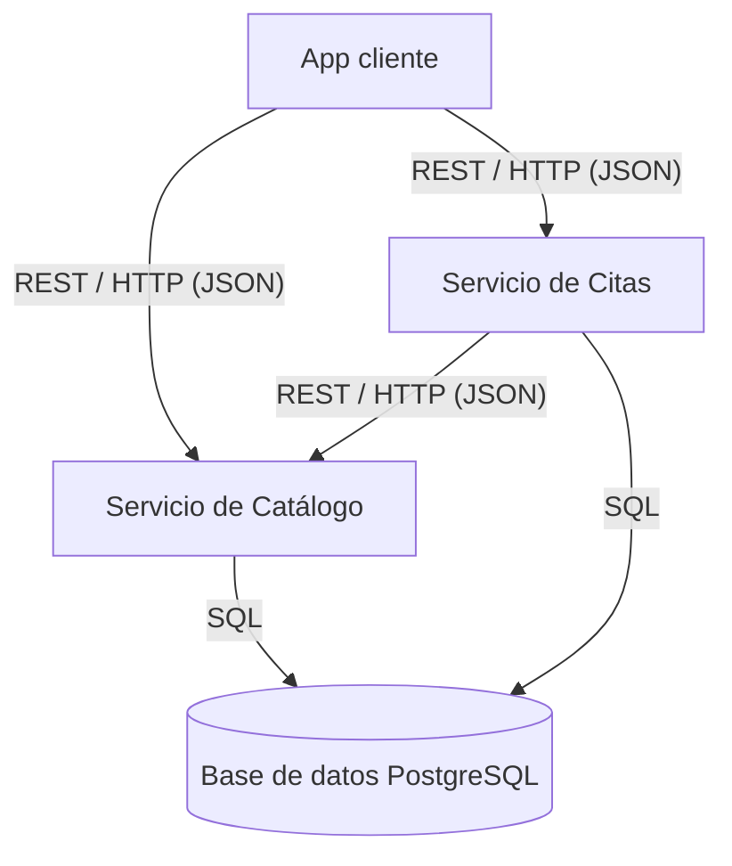

# Plataforma de Citas para Salón de Uñas

Proyecto de la asignatura **Cloud Computing: Fundamentos e Infraestructuras** — Máster Universitario en Ingeniería Informática, ETSIIT, Universidad de Granada (curso 2026-2027).

Aplicación nativa de la nube (*Cloud-Native Application*) para gestionar las citas de un salón de uñas: catálogo de servicios, cálculo automático de precio y duración, búsqueda de huecos disponibles y gestión de reservas.

---

## Índice

1. [Descripción del dominio](#1-descripción-del-dominio)
2. [Justificación NIST SP 800-145](#2-justificación-nist-sp-800-145)
3. [Mapeo de actores NIST SP 500-292](#3-mapeo-de-actores-nist-sp-500-292)
4. [Arquitectura](#4-arquitectura)
5. [Especificación de la API REST](#5-especificación-de-la-api-rest)
6. [Gestión del proyecto](#6-gestión-del-proyecto)
7. [Mejoras futuras](#7-mejoras-futuras)

---

## 1. Descripción del dominio

### Problema de negocio

Muchos salones de uñas gestionan su negocio casi exclusivamente a través de Instagram: los clientes consultan precios, piden citas, las cambian o las cancelan mediante mensajes directos. Cuando el volumen de mensajes es alto, este sistema es difícil de controlar:

- Los mensajes se acumulan y algunos se pierden o se responden con mucho retraso.
- El personal dedica mucho tiempo a responder preguntas repetidas (precios, duración, disponibilidad).
- Se producen errores de agenda: citas solapadas, huecos mal calculados o cancelaciones no registradas.
- Los clientes que no reciben una respuesta rápida acaban reservando en otro salón.

### Solución propuesta

Una aplicación que automatiza la gestión de citas del salón. El cliente consulta el catálogo, obtiene el precio y la duración exactos de la combinación de servicios que elige y reserva directamente un hueco disponible. El salón deja de depender de los mensajes de Instagram para la gestión diaria.

### Lógica de negocio

La aplicación no se limita a guardar y mostrar datos (no es un CRUD trivial). Aplica las siguientes reglas:

- **Cálculo de precio y duración:** cada cita es una combinación de un servicio base (ej. manicura BIAB) y extras (ej. francesa, retirada de gel, diseño en varias uñas). El sistema calcula el precio y la duración totales, incluyendo extras cuyo precio depende del número de uñas.
- **Búsqueda de huecos:** solo se muestran los huecos en los que un técnico trabaja y tiene libre todo el tiempo que dura el servicio.
- **Prevención de solapamientos:** un técnico no puede tener dos citas que coincidan en el tiempo.
- **Política de cancelación:** una cita solo puede cancelarse hasta 24 horas antes. Al cancelar, el hueco se libera automáticamente.

### Catálogo de ejemplo

| Servicio base | Precio | Duración |
|---|---|---|
| Manicura simple | 25 € | 45 min |
| Manicura japonesa | 35 € | 60 min |
| Manicura BIAB | 40 € | 75 min |
| Extensiones | 65 € | 120 min |
| Pedicura simple | 35 € | 60 min |
| Pedicura japonesa | 45 € | 75 min |
| Pedicura BIAB | 45 € | 80 min |

| Extra | Precio | Duración |
|---|---|---|
| Francesa / Cromo / Ombré | +10 € | +15 min |
| Cat eye | +7 € | +10 min |
| Diseño (por uña) | +2 € | +5 min |
| Reparación (por uña) | +3 € | +10 min |
| Retirada de gel o BIAB | +15 € | +20 min |

### Casos de uso principales

- **Consultar el catálogo:** ver los servicios base y los extras con sus precios y duraciones.
- **Calcular precio y duración:** obtener el total de la combinación elegida.
- **Consultar disponibilidad:** ver los huecos libres de una fecha con duración suficiente para el servicio elegido.
- **Reservar una cita:** confirmar un hueco con un técnico; el sistema impide los solapamientos.
- **Cancelar una cita:** permitido solo hasta 24 h antes; el hueco queda libre de nuevo.
- **Consultar la agenda del día:** cada técnico ve sus citas de una fecha.

---

## 2. Justificación NIST SP 800-145

La aplicación aprovecha las cinco características esenciales del Cloud Computing definidas por el NIST:

| Característica | Aplicación en el proyecto |
|---|---|
| **Autoservicio bajo demanda** | El salón puede desplegar, ampliar o reducir los recursos (instancias, base de datos) de forma automática mediante código (Terraform) y pipelines de CI/CD, sin intervención manual del proveedor. |
| **Acceso amplio a la red** | Los clientes reservan desde cualquier dispositivo (móvil, tablet, ordenador) a través de Internet mediante una API REST sobre HTTP, a cualquier hora, sin depender de que alguien responda mensajes. |
| **Asignación común de recursos** | La aplicación se ejecuta sobre la infraestructura compartida del proveedor cloud, que reparte sus recursos físicos entre muchos clientes. El salón no necesita comprar ni mantener servidores propios. |
| **Rápida elasticidad** | La demanda del salón tiene picos claros: viernes por la tarde, sábados y fechas previas a festivos, bodas o Navidad, frente a mañanas entre semana con poca actividad. Los servicios en contenedores pueden escalar para atender los picos y reducirse en los periodos tranquilos. |
| **Servicio medido** | El proveedor mide el uso de cómputo, almacenamiento y red, y el salón paga solo por lo que consume. En los periodos de poca demanda el coste se reduce. |

---

## 3. Mapeo de actores NIST SP 500-292

| Actor | Quién es en este proyecto |
|---|---|
| **Consumidor cloud** | El salón de uñas, que contrata los servicios cloud para ejecutar su aplicación. Indirectamente, sus clientes y técnicos usan la aplicación desplegada. |
| **Proveedor cloud** | El proveedor de infraestructura donde se despliega la aplicación (nube pública con capa gratuita o créditos de estudiante, o nube privada propia), en una región de la Unión Europea. |
| **Intermediario (*broker*)** | No se utiliza en esta versión: el salón contrata directamente al proveedor. Podría aparecer si el salón usara un servicio que gestione varios proveedores o un marketplace de software. |
| **Auditor** | Entidad independiente que puede evaluar la seguridad y el cumplimiento normativo. Es relevante porque la aplicación almacena datos personales de clientes (nombre, email, teléfono, historial de citas), sujetos al RGPD, cuya autoridad de control en España es la AEPD. |
| **Operador (*carrier*)** | Los operadores de telecomunicaciones y proveedores de Internet que conectan a los clientes y al salón con la infraestructura del proveedor cloud. |

### Impacto económico

- **De CapEx a OpEx:** el salón no realiza una inversión inicial en servidores; paga un coste operativo mensual proporcional al uso.
- **Pago por uso:** gracias a la elasticidad, en los periodos de poca demanda el coste es menor que el de un servidor propio dimensionado para los picos.
- **Ahorro de tiempo del personal:** las horas que antes se dedicaban a responder mensajes de Instagram se pueden dedicar a atender clientes.
- **Menos pérdidas de clientes:** la reserva inmediata evita perder clientes por respuestas lentas y reduce los errores de agenda.

---

## 4. Arquitectura

La aplicación sigue una arquitectura de microservicios desacoplados que se comunican mediante una API REST.



### Componentes

| Componente | Responsabilidad |
|---|---|
| **Servicio de Catálogo** | Gestiona los servicios base y los extras. Calcula el precio y la duración totales de una combinación. |
| **Servicio de Citas** | Gestiona los técnicos y sus horarios, calcula los huecos disponibles, crea citas sin solapamientos y aplica la política de cancelación. Consulta al Servicio de Catálogo para conocer la duración de los servicios. |
| **PostgreSQL** | Capa de persistencia. Almacena servicios, extras, técnicos, horarios y citas. |

### Protocolos de comunicación

| Origen → Destino | Protocolo |
|---|---|
| App cliente → Catálogo / Citas | REST sobre HTTP, con datos en JSON |
| Citas → Catálogo | REST sobre HTTP, con datos en JSON |
| Catálogo / Citas → PostgreSQL | SQL sobre TCP |

---

## 5. Especificación de la API REST

### Servicio de Catálogo

| Método | Ruta | Descripción |
|---|---|---|
| `GET` | `/services` | Lista los servicios base |
| `GET` | `/extras` | Lista los extras |
| `POST` | `/quote` | Calcula el precio y la duración de una combinación |

**Ejemplo — `POST /quote`**

Petición:
```json
{
  "service_id": "manicura-biab",
  "extras": [
    { "extra_id": "francesa" },
    { "extra_id": "diseno", "nails": 2 }
  ]
}
```

Respuesta `200 OK`:
```json
{
  "total_price": 54,
  "total_duration_minutes": 100
}
```

### Servicio de Citas

| Método | Ruta | Descripción |
|---|---|---|
| `GET` | `/technicians` | Lista los técnicos |
| `GET` | `/availability?date=2026-11-14&duration=100` | Huecos libres de una fecha con duración suficiente |
| `POST` | `/appointments` | Crea una cita |
| `DELETE` | `/appointments/{id}` | Cancela una cita (solo hasta 24 h antes) |
| `GET` | `/technicians/{id}/appointments?date=2026-11-14` | Agenda de un técnico en una fecha |

**Ejemplo — `GET /availability?date=2026-11-14&duration=100`**

Respuesta `200 OK`:
```json
[
  { "technician_id": 1, "start": "2026-11-14T10:00:00", "end": "2026-11-14T11:40:00" },
  { "technician_id": 2, "start": "2026-11-14T16:30:00", "end": "2026-11-14T18:10:00" }
]
```

**Ejemplo — `POST /appointments`**

Petición:
```json
{
  "client_name": "Laura Pérez",
  "client_email": "laura@example.com",
  "technician_id": 1,
  "service_id": "manicura-biab",
  "extras": [{ "extra_id": "francesa" }, { "extra_id": "diseno", "nails": 2 }],
  "start": "2026-11-14T10:00:00"
}
```

Respuesta `201 Created`:
```json
{
  "id": 42,
  "technician_id": 1,
  "start": "2026-11-14T10:00:00",
  "end": "2026-11-14T11:40:00",
  "total_price": 54,
  "status": "confirmed"
}
```

Respuesta `409 Conflict` si el hueco ya está ocupado:
```json
{ "error": "El técnico ya tiene una cita en ese horario" }
```

**Ejemplo — `DELETE /appointments/42`**

- `204 No Content` si la cancelación se realiza con más de 24 h de antelación.
- `422 Unprocessable Entity` si faltan menos de 24 h:
```json
{ "error": "Las citas solo pueden cancelarse hasta 24 horas antes" }
```

---

## 6. Gestión del proyecto

### Estrategia de ramas

- `main`: rama principal, siempre estable.
- `feature/<nombre>`: una rama por funcionalidad o tarea (ej. `feature/catalog-quote`). Se integra en `main` mediante *Pull Request*.

### Convención de commits

Se siguen los commits semánticos:

- `feat:` nueva funcionalidad
- `fix:` corrección de errores
- `docs:` cambios en la documentación
- `refactor:` cambios internos sin modificar el comportamiento

### Tablero y backlog

- El backlog se gestiona en **GitHub Projects**, con vistas agrupadas por *Milestones* (Hito 1 a Hito 5).
- Las historias de usuario se registran como *GitHub Issues* con la etiqueta `user-story`, criterios de aceptación y una lista de tareas.
- Plantillas: `.github/ISSUE_TEMPLATE/user_story.md` y `.github/PULL_REQUEST_TEMPLATE.md`.

---

## 7. Mejoras futuras

Funcionalidades que quedan fuera del alcance de esta versión:

- Notificaciones por email (confirmación y recordatorios).
- Habilidades por técnico (no todos realizan todos los servicios).
- Servicio "a 4 manos" (dos técnicos simultáneamente).
- Gestión de varios salones en la misma plataforma.
